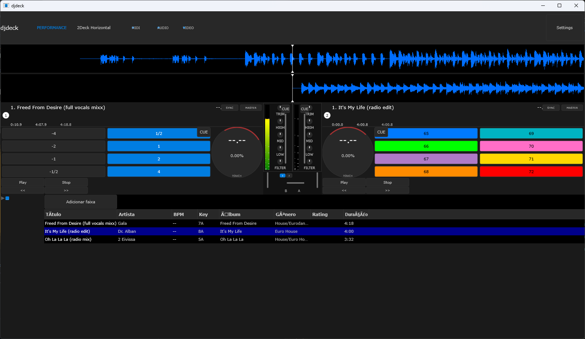

# djdeck

Aplicação de DJ para desktop com **dois decks**, mixer, equalizador de 3 bandas, filtro, crossfader, playlist e seletor de dispositivo de áudio, escrita em C++17 sobre o framework [JUCE](https://juce.com).

> Projeto **independente**, com identidade e roadmap próprios. A estrutura dos decks e da playlist foi inspirada no [TheAudioProgrammer/juceDjApp](https://github.com/TheAudioProgrammer/juceDjApp).



> **Status:** `v0.3.0` — versão estável com mixer completo, equalizador, filtro, crossfader, big/mini waveform sincronizadas e testes automatizados.
> Compila sem erros nem warnings, abre corretamente, e o fluxo principal (importar faixa → arrastar para um deck → reproduzir) está verificado em execução.

O [roadmap completo](docs/ROADMAP.md) está em [`docs/ROADMAP.md`](docs/ROADMAP.md). O guia detalhado de layout, cores e componentes está em [`docs/DOCUMENTACAO_LAYOUT_UI.md`](docs/DOCUMENTACAO_LAYOUT_UI.md).

---

## Funcionalidades

| Recurso | Situação |
|---|---|
| Dois decks independentes (Play/Stop/<< />>) | ✅ Funcionando |
| Mixer de 2 canais com crossfader | ✅ Funcionando |
| Gain por deck (0.0 – 1.0) | ✅ Funcionando |
| Equalizador de 3 bandas (LOW/MID/HIGH) | ✅ Funcionando |
| Filtro passa-baixa / passa-alta bipolar | ✅ Funcionando |
| Velocidade de reprodução (0.5× – 3.0×) | ✅ Funcionando |
| Posição da faixa (seek) | ✅ Funcionando |
| Waveform com playhead em tempo real | ✅ Funcionando |
| Big waveform (agulha fixa, onda rolante) | ✅ Funcionando |
| Mini waveform (faixa estática, agulha móvel) | ✅ Funcionando |
| Carregamento via FileInputSource (sem ler arquivo inteiro em memória) | ✅ Funcionando |
| Playlist com colunas de título / artista / duração | ⚠️ Metadados ainda não extraídos |
| Arrastar faixa da playlist para um deck | ✅ Funcionando |
| Duplo-clique na playlist carrega no Deck 1 | ✅ Funcionando |
| Arrastar arquivo do Explorer para a playlist | ✅ Funcionando |
| Arrastar arquivo do Explorer para um deck | ✅ Funcionando |
| Diálogo de configuração de áudio (device / sample rate / buffer size) | ✅ Funcionando |
| Detecção de troca de dispositivo de áudio | ✅ Funcionando (apenas loga) |
| Testes automatizados (Catch2) | ✅ Implementados |

### Formatos de áudio suportados

O `AudioFormatManager` registra os formatos básicos do JUCE:

- WAV / AIFF
- FLAC
- Ogg Vorbis
- MP3

---

## Como usar

1. **Adicionar faixa** — clique em `Adicionar faixa` e escolha um ou mais arquivos. Também é possível arrastar arquivos do Explorer para a playlist.
2. **Carregar num deck** — arraste a linha da playlist até o deck desejado (o deck em destaque mostra “Solte para carregar”), ou dê duplo-clique para carregar no Deck 1.
3. **Reproduzir** — `Play` inicia, `Stop` para e volta ao início.
4. **Ajustar** — o slider esquerdo é o **gain**, o do meio a **velocidade** (0.50× a 3.00×) e o slider inferior a **posição** na faixa.
5. **Mixer** — use os controles de crossfader, TRIM, EQ (LOW/MID/HIGH) e filtro de cada canal.
6. **Configurar áudio** — o botão `Settings` abre o seletor de dispositivo, sample rate e tamanho do buffer.

---

## Requisitos

| Item | Versão |
|---|---|
| CMake | ≥ 3.22 |
| Compilador | C++17 (MSVC 2019+, GCC 9+, Clang 10+) |
| JUCE | 9.0.5 (baixada automaticamente via `FetchContent`) |
| SO | Windows, macOS ou Linux |

Não é preciso instalar o JUCE manualmente — o `CMakeLists.txt` faz o download automaticamente na primeira configuração.

> **Nota sobre o Windows:** o projeto usa runtime estático do MSVC (`/MT`), então o `.exe` gerado não depende de DLLs redistribuíveis do Visual C++.

---

## Compilando

### Windows (Visual Studio 2022)

```powershell
cmake -B Builds -G "Visual Studio 17 2022" -A x64
cmake --build Builds --config Release --target djdeck
```

O executável fica em:

```
Builds/djdeck_artefacts/Release/djdeck.exe
```

### Linux / macOS

```bash
cmake -B Builds -DCMAKE_BUILD_TYPE=Release
cmake --build Builds --config Release --target djdeck
```

O executável fica em `Builds/djdeck_artefacts/Release/djdeck`.

### Testes automatizados

O projeto inclui uma suíte de testes com Catch2 (opcional, ativada por padrão):

```bash
cmake -B Builds -DJDECK_ENABLE_TESTS=ON
cmake --build Builds --config Debug --target djdeck_tests
```

### Dependências no Linux

```bash
sudo apt install libasound2-dev libfreetype6-dev libx11-dev \
                 libxinerama-dev libxrandr-dev libxcursor-dev \
                 libgl1-mesa-dev xvfb
```

---

## Estrutura do projeto

```
djdeck/
├── CMakeLists.txt              # build FetchContent do JUCE + módulos
├── Source/
│   ├── Main.cpp                # ponto de entrada (JUCEApplication)
│   ├── MainComponent.h/.cpp    # janela, mixer, layout, drag-and-drop
│   ├── DeckComponent.h/.cpp    # UI de um deck (transport, pads, jog)
│   ├── DeckPlayer.h/.cpp       # áudio de um deck (transporte, DSP, ganho)
│   ├── BigWaveformComponent.h/.cpp  # onda rolante, agulha fixa no centro
│   ├── MiniWaveformComponent.h/.cpp # onda estática, agulha móvel
│   ├── MixerComponent.h/.cpp   # UI do mixer (strips, crossfader)
│   ├── ChannelStripComponent.h/.cpp # UI de um canal (VU, TRIM, EQ, filtro, fader)
│   ├── LibraryComponent.h/.cpp# biblioteca (árvore + lista de faixas)
│   ├── LibraryStore.h/.cpp     # persistência XML da biblioteca
│   ├── Song.h/.cpp             # modelo de uma faixa
│   ├── RekordboxLookAndFeel.h/.cpp# LookAndFeel customizado
│   ├── RekordboxColours.h      # paleta de cores medida no Rekordbox
│   ├── SettingsDialog.h        # diálogo de dispositivo de áudio
│   └── TagLibReader.h/.cpp     # leitura de metadados (ID3, Vorbis, MP4, APE)
├── tests/
│   ├── main.cpp                # ponto de entrada dos testes (inicializa JUCE)
│   ├── test_song.cpp           # testes de Song / metadados
│   ├── test_deckplayer.cpp     # testes de DeckPlayer (ganho, cue, speed, posição)
│   ├── test_crossfader.cpp     # testes de CrossfaderComponent (curva constant power)
│   └── test_waveform.cpp       # testes de waveform (MP3, FileInputSource, caches)
├── docs/
│   ├── ROADMAP.md              # planejamento e decisões de arquitetura
│   └── DOCUMENTACAO_LAYOUT_UI.md # guia de estilo, layout e componentes
└── Builds/                     # artefatos de build (ignorado pelo git)
```

### Como as peças se conectam

```
Main.cpp (DJApplication)
  └── MainWindow (DocumentWindow)
        └── MainComponent (AudioAppComponent + DragAndDropContainer)
              ├── mixerSource (MixerAudioSource)  ← saída para o dispositivo
              │     ├── deckPlayer1 (DeckPlayer)
              │     └── deckPlayer2 (DeckPlayer)
              ├── deck1 / deck2 (DeckComponent)   ← UI + alvo de drop
              ├── mixer (MixerComponent)          ← UI do mixer
              ├── library (LibraryComponent)      ← árvore + lista de faixas
              └── settingsDialog (SettingsDialog) ← config de áudio
```

O fluxo do áudio por deck é:

```
arquivo → AudioFormatReader → AudioFormatReaderSource → AudioTransportSource
        → ResamplingAudioSource (gain + velocidade) → [Trim/EQ/Filtro/Crossfade]
        → MixerAudioSource → saída
```

---

## Notas de implementação

Alguns pontos que exigem atenção ao mexer no código:

- **Versão:** definida como `0.3.0` em `CMakeLists.txt` e `Source/Main.cpp` (`ProjectInfo::versionString`).
- **`MainComponent` herda de `juce::DragAndDropContainer`.** Ele é um *mixin* (não deriva de `Component`), então convive com `juce::AudioAppComponent`. É ele que fornece `startDragging()` e roteia os eventos de drop.
- **`setSize()` vem depois de `addAndMakeVisible()`.** `setSize()` dispara `resized()`, e é `resized()` que distribui os bounds entre os filhos. Chamar `setSize()` antes dos filhos existirem resulta em **tela preta**.
- **`juce::Array::getUnchecked()` e `operator[]` retornam por valor** no JUCE 9. Pegar o endereço (`&`) de um deles gera um ponteiro para um temporário. Use `getReference()`.
- **O `AudioThumbnail` não copia o buffer.** Ele mantém o ponteiro e o lê numa thread de background, então o `AudioBuffer` precisa viver enquanto o thumbnail o usa — por isso `waveformBuffer` é um member de `WaveformDisplay`.
- **`thumbnailCache` é declarado antes dos decks.** Membros são destruídos na ordem inversa da declaração, e o `AudioThumbnail` de cada deck acessa esse cache no shutdown.
- **Não redeclare `deviceManager` em `MainComponent`.** `AudioAppComponent` já expõe `protected AudioDeviceManager& deviceManager`; declarar outro member com o mesmo nome cria dois managers distintos e um gerencia um device morto.
- **`DeckComponent` usa `setInterceptsMouseClicks(true, true)`.** O JUCE localiza o alvo do drop via `getComponentAt()` → `hitTest()`. Com `false`, o hit-test falha nas áreas do deck sem filho e o drop é ignorado silenciosamente.
- **Waveform carrega via `FileInputSource`, não via `AudioBuffer` inteiro.** Isso evita carregar arquivos longos na memória. O `AudioThumbnail` assume a posse do source e o destrói quando substituído.
- **Caches separados:** `miniThumbnailCache` e `bigThumbnailCache` são instâncias distintas de `juce::AudioThumbnailCache` em `MainComponent`, evitando corrupção entre a mini e a big waveform do mesmo arquivo.
- **Sincronização deck↔waveform:** `DeckComponent` expõe um callback `onTrackLoaded` para que o `MainComponent` possa atualizar a UI quando uma faixa é carregada, evitando includes circulares.

---

## Estado do projeto

Os itens planejados — extração de metadados com TagLib, BPM, detecção de BPM por áudio, fonte customizada, interpolação de pitch, espectro em tempo real, segunda saída de áudio (fone), DVS — estão detalhados em [docs/ROADMAP.md](docs/ROADMAP.md).

O **layout seguirá a temática do Rekordbox**: biblioteca de faixas à esquerda, decks lado a lado à direita, tema escuro e alto contraste entre a waveform e o fundo. O `LookAndFeel` próprio é o que vai concretizar isso.

Duas decisões de arquitetura já tomadas:

- **TagLib** será a biblioteca de metadados (substitui a leitura manual atual).
- **Xwax não será usado.** O projeto não vai trabalhar com timecode, então não há motivo para trazer essa dependência — e com ela, o DVS/vinyl control fica fora do escopo por ora.

### Pendências conhecidas

- **Acentuação quebrada nos textos da interface.** O cabeçalho “Duração” aparece como `Duração` e “Título” como `TÃtulo`. A causa está identificada: no JUCE 9, `juce::String(const char*)` interpreta os bytes como **ASCII/Latin-1** (`CharPointer_ASCII`), não como UTF-8. A flag `/utf-8` já foi adicionada ao `CMakeLists.txt` para o compilador ler os fontes corretamente, mas a conversão para Unicode precisa ser explícita via `juce::String::fromUTF8()`. A correção está pendente.
- A coluna **duração** exibe sempre `0:00` e o **artista** sempre *“Artista desconhecido”* — os metadados ainda não são extraídos dos arquivos.
- A playlist não é persistida entre execuções.

---

## Agradecimentos

- [JUCE](https://github.com/juce-framework/JUCE) — framework de áudio e GUI.
- [TheAudioProgrammer/juceDjApp](https://github.com/TheAudioProgrammer/juceDjApp) — projeto de referência usado como base para a estrutura dos decks e da playlist.

---

## Licença

Este projeto está sob a licença **AGPL-3.0** — a mesma do JUCE — para que a combinação com o framework permaneça compatível com a distribuição.

O framework [JUCE](https://juce.com/legal/juce-9-licence/) é duamente licenciado: **AGPLv3** ou licença comercial da JUCE. Se você pretende distribuir esta aplicação de forma fechada, é necessário obter uma licença comercial da JUCE.

O texto completo da licença está em [`LICENSE`](LICENSE).